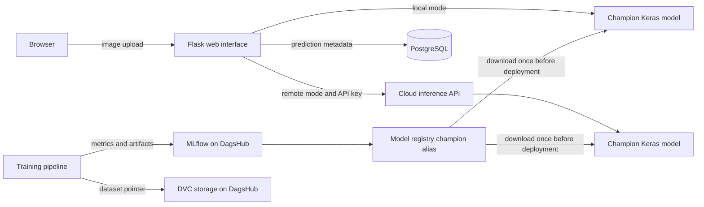
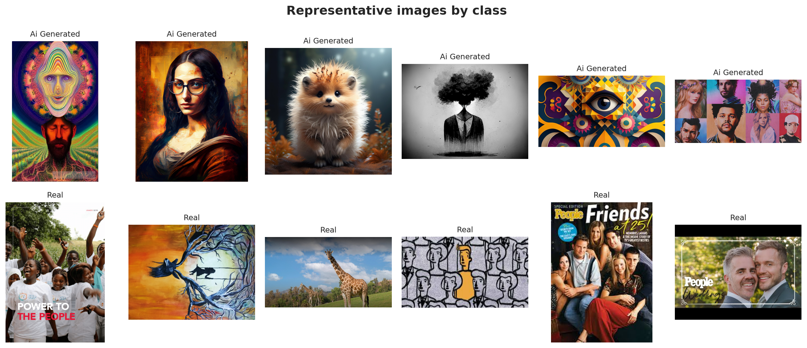
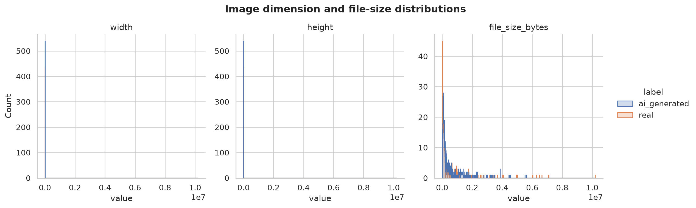

# VisionGuard AI Image Detector

[](https://github.com/RaoHaris535/Visionguard-AI-Image-Detector/actions/workflows/ci.yml)
[](https://www.python.org/)
[](https://www.tensorflow.org/)
[](https://mlflow.org/)

VisionGuard is an end-to-end MLOps project that classifies an uploaded image as AI-generated or real. It pairs reproducible TensorFlow training with DVC data versioning, MLflow experiment tracking, model-registry promotion, a Flask interface, a permanent PostgreSQL audit trail, Docker Compose, automated tests, and a separately deployable inference API.

The application reports a probabilistic signal rather than claiming forensic certainty. Every stored result records the decision, confidence, threshold, model version, inference source, timestamp, and a SHA-256 content hash. Uploaded image bytes are processed in memory and are not retained by the web application.

## System design



The serving process never contacts DagsHub for individual predictions. The champion artifact is downloaded during a controlled release step and packaged into or mounted by the container.

## Project capabilities

- Dataset audit with dimensions, color mode, format, byte size, SHA-256 hash, corrupt-file detection, and exact-duplicate detection
- Stratified train, validation, and test manifests generated with a fixed seed
- `tf.data` decoding, aspect-ratio-preserving padding, batching, augmentation, and prefetching
- Custom convolutional baseline and two-stage MobileNetV2 transfer learning
- Validation-only threshold selection followed by a single final test evaluation
- Accuracy, precision, recall, F1, ROC-AUC, confusion matrix, ROC curve, and error analysis
- Manual MLflow logging and TensorFlow autologging with Git and DVC lineage tags
- Keras Tuner experiments and MLflow Model Registry promotion
- Local inference and API-backed inference through the same user interface
- File-type, file-size, and actual-image validation with friendly error responses
- PostgreSQL history with no externally published database port
- Reproducible non-root Docker images and Compose health dependencies
- GitHub Actions on Python 3.11 and 3.12, plus a container build check

## Dataset audit preview

The downloaded dataset contains 975 readable files: 539 AI-generated and 436 real images. One exact-duplicate pair is excluded before the deterministic split, leaving 681 training, 146 validation, and 146 test examples. The complete numeric interpretation is documented in the [dataset audit](docs/data-audit.md).





## Repository layout

```text
configs/                  Reproducible experiment settings
data/                     DVC-managed data and tracked split manifests
docs/                     Architecture, operations, deployment, and evidence guidance
models/                   Champion model destination, managed outside ordinary Git
reports/                  Generated figures, screenshots, and report sources
scripts/                  Auditing, training, tuning, registry, and evidence commands
src/visionguard/          Installable application package
tests/                    Fast automated tests
toy/                      Isolated DVC, MLflow, Keras Tuner, and CI exercises
compose.yaml              Local Flask and PostgreSQL stack
Dockerfile                Local web application image
Dockerfile.api            Cloud inference API image
```

## Quick start

### 1. Create the environment

Install [uv](https://docs.astral.sh/uv/), then run:

```bash
uv python install 3.12
uv sync --extra dev
uv run python -c "import tensorflow as tf; print(tf.__version__); print(tf.config.list_physical_devices('GPU'))"
```

The project pins Python below 3.14 because the stable TensorFlow wheel used here supports Python 3.10 through 3.13.

### 2. Configure secrets

```bash
cp .env.example .env
chmod 600 .env
```

Replace all placeholder values. `.env` and `.dvc/config.local` are ignored by Git. Never put a DagsHub token, database password, Kaggle token, or cloud credential in source code, Dockerfiles, Compose YAML, or GitHub workflow files.

### 3. Prepare and version the dataset

Download the Kaggle dataset named **AI Generated Images vs Real Images** and arrange it under `data/raw` with one top-level folder per class. Then run:

```bash
make audit
make split
dvc add data/raw
git add data/raw.dvc data/.gitignore data/splits
```

Configure the DagsHub DVC remote with the repository-specific commands shown under **Remote → Data → DVC** on DagsHub. Keep access keys in `.dvc/config.local` by using `dvc remote modify --local`.

### 4. Run the model workflow

```bash
make train
make tune
```

The baseline uses explicit MLflow logging. The transfer-learning run uses TensorFlow autologging. The training pipeline selects a decision threshold from validation predictions and evaluates the held-out test split only after that choice.

### 5. Start the application

Place the promoted model at `models/champion.keras`, configure `.env`, and run:

```bash
make web
```

Open [http://localhost:8000](http://localhost:8000). For the complete local stack:

```bash
docker compose up --build -d
docker compose ps
curl http://localhost:8000/health
```

The database service is accessible to the web container as `db:5432` but deliberately has no published host port.

## Testing and quality checks

```bash
make lint
make test
docker build -t visionguard:web .
docker build -f Dockerfile.api -t visionguard:api .
```

Some workflows require external services or generated artifacts and are intentionally separate from fast unit tests.

## Experiment and release policy

Each meaningful experiment changes one primary variable, such as augmentation, learning rate, image size, dropout, backbone state, or number of unfrozen layers. Runs record the Git commit, DVC data version, seed, hyperparameters, epoch metrics, final metrics, plots, split manifests, environment packages, and model artifact.

The best model is registered as `visionguard-classifier`. A model version receives the `champion` alias only after its validation threshold and test evaluation have been recorded. Deployment downloads that exact version once; request handling does not depend on DagsHub availability.

## Security and privacy

- The application enforces an upload-size limit and decodes content instead of trusting extensions.
- Filenames are sanitized before they enter logs or database records.
- Uploaded bytes are not written to disk by the application.
- The cloud inference endpoint requires a constant-time API-key comparison.
- Containers run as a non-root user.
- PostgreSQL is isolated on the Compose network.
- Repository secrets belong in GitHub Actions secrets, never in workflow YAML.
- The classifier must not be used as the sole basis for disciplinary, legal, employment, or moderation decisions.

## Documentation

- [Operations and troubleshooting](docs/operations.md)
- [Cloud API deployment](docs/deployment.md)
- [Assessment evidence checklist](docs/evidence-checklist.md)

## Data and licensing

Source code is provided under the MIT License. The dataset is not redistributed in this repository. Dataset users must follow the license and usage terms published by the original Kaggle dataset owner.

## AI assistance disclosure

OpenAI Codex was used to help plan the repository structure, draft implementation code, create tests and documentation, and review reproducibility and security controls. The student remains responsible for running the experiments, validating results, understanding every command and design decision, and disclosing this assistance in the submitted report.
